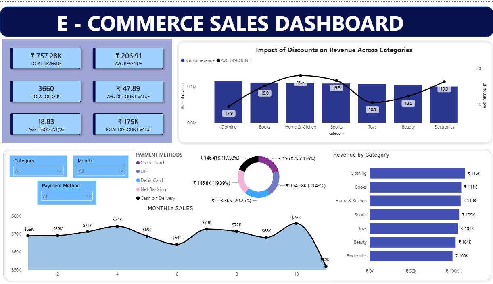

# 🛒 E-Commerce Sales Analytics

An end-to-end **e-commerce data analytics project** that turns raw transaction records into business-ready insights using **Python, SQL, and Power BI**.

The project explores how an online store performs across product categories, months, payment methods, and discount levels. It includes data preparation, exploratory data analysis (EDA), SQL-based analysis, and an interactive Power BI dashboard designed to help users quickly understand sales performance.

<p align="center">
  
</p>

<p align="center">
  <b>Explore the data • Understand sales trends • Evaluate discounting • Communicate insights</b>
</p>

---

## 📌 At a glance

| Item | Details |
|---|---|
| Project | E-Commerce Sales Analytics |
| Domain | Retail / E-commerce / Business Intelligence |
| Dataset size | 3,660 transaction records |
| Time period | 2024 (as represented in the dataset) |
| Main tools | Python, SQL, Power BI |
| Python libraries | Pandas, NumPy, Matplotlib, Seaborn |
| Dashboard file | `E-CommerceSalesDashboard.pbix` |
| SQL analysis | `Queries.sql` |

## 🎯 Why this project?

E-commerce businesses generate transaction data every time a customer places an order. That data can answer important business questions:

- How much revenue is the store generating?
- How many transactions are recorded, and what is the average order value?
- Which product categories contribute the most revenue?
- How do sales change from month to month?
- Which payment methods do customers use?
- How much revenue is associated with different discount levels?
- Are discounts helping attract sales, and are larger discounts necessarily better?

This project follows an analytics workflow to answer these questions and present the results in a single interactive dashboard.

## 📊 Dashboard walkthrough

The Power BI report brings the main performance indicators and supporting charts together on one page.

### 1. KPI cards — overall business performance

The top-left cards provide a quick snapshot of the dataset:

| KPI | What it tells you |
|---|---|
| **Total Revenue** | Sum of the final transaction values |
| **Average Revenue** | Average revenue per recorded transaction (average order value in this dataset) |
| **Total Orders** | Number of transaction records |
| **Average Discount Value** | Average monetary reduction from the original price |
| **Average Discount (%)** | Mean discount percentage applied |
| **Total Discount Value** | Combined monetary value of discounts |

The dashboard screenshot shows approximately **₹757.28K total revenue**, **3,660 orders**, **₹206.91 average revenue**, **18.83% average discount**, **₹47.89 average discount value**, and **₹175K total discount value**. Values can change when dashboard filters are applied.

### 2. Discount impact across product categories

The combo chart compares two measures for each category:

- **Revenue** — shown as columns.
- **Average discount** — shown as a line.

Categories include Clothing, Books, Home & Kitchen, Sports, Toys, Beauty, and Electronics.

This view helps compare discounting patterns with revenue across categories. It is useful for identifying categories with relatively high discounts and asking whether those discounts are accompanied by stronger sales.

**Important:** A chart showing revenue and average discount together describes an association in the observed data. It does not, by itself, prove that discounts caused revenue to increase or decrease.

### 3. Payment method distribution

The doughnut chart breaks down transactions or revenue across the payment methods represented in the report:

- Credit Card
- UPI
- Debit Card
- Net Banking
- Cash on Delivery

Use it to understand the payment mix and compare the contribution of each payment method. The exact interpretation of the displayed values depends on the measure configured in the Power BI visual.

### 4. Monthly sales trend

The area/line chart tracks revenue by month. It makes it easier to spot:

- Higher- and lower-revenue months.
- Month-to-month fluctuations.
- Potential seasonal patterns worth investigating.
- Sudden changes that may need further business context.

The screenshot shows revenue staying in a broadly similar range for much of the displayed period, with a visible decline in the final plotted month. This should be investigated alongside transaction counts and data coverage before drawing conclusions.

### 5. Revenue by category

The horizontal bar chart ranks categories by total revenue. In the shown report, Clothing is the leading category, followed closely by Books, Home & Kitchen, Sports, Toys, Beauty, and Electronics.

This view helps identify where sales are concentrated and where category-level marketing or merchandising analysis may be useful.

### 6. Interactive slicers

The dashboard includes slicers for:

- **Category** — focus on one or more product categories.
- **Month** — analyse a selected month or group of months.
- **Payment Method** — compare payment behaviour across methods.

Selecting a slicer updates the connected visuals so you can investigate a particular slice of the business rather than relying only on overall totals.

---

## 🧾 Dataset and fields

The repository includes the original/updated dataset and a cleaned dataset:

- `ecommerce_dataset_updated.csv`
- `cleaned_ecommerce.csv`

The transaction data contains the following key columns:

| Column | Description |
|---|---|
| `user_id` | Identifier associated with the customer |
| `product_id` | Identifier associated with the purchased product |
| `category` | Product category |
| `price_rs` | Product price before discount, in rupees |
| `discount_` | Discount percentage |
| `final_pricers` | Final price after discount, in rupees |
| `payment_method` | Payment method used |
| `purchase_date` | Date of the transaction |

The analysis notebook adds useful derived fields:

| Derived column | Meaning |
|---|---|
| `revenue` | Final transaction value; derived from `final_pricers` |
| `discount_value` | Monetary discount: `price_rs - final_pricers` |
| `month` | Month extracted from the purchase date |
| `year` | Year extracted from the purchase date |

### Dataset note

The notebook output shows **3,660 rows** and 3,660 distinct `user_id` values in the cleaned transaction data. In this dataset, that means each listed user appears once. As a result, repeat-purchase frequency and retention behaviour cannot be meaningfully measured from these records alone. Customer segmentation based on repeat purchasing or full RFM analysis would require multiple dated transactions for the same customer.

---

## ⚙️ Project workflow

The project is organised around a practical analytics lifecycle:

```text
Transaction Dataset (CSV)
          │
          ▼
Data Inspection & Cleaning
          │
          ├── Missing-value checks
          ├── Duplicate checks
          ├── Column-name standardisation
          └── Date and data-type conversion
          │
          ▼
Feature Engineering
          │
          ├── Revenue
          ├── Discount Value
          ├── Month
          └── Year
          │
          ├──────────────────────┐
          ▼                      ▼
Python EDA                 SQL Analysis
          │                      │
          ├── Distributions       ├── KPI calculations
          ├── Category analysis  ├── Monthly revenue
          ├── Payment analysis   ├── Category revenue
          ├── Discount analysis  └── Customer totals
          │                      │
          └──────────┬───────────┘
                     ▼
             Power BI Dashboard
                     │
                     ▼
          Interactive Business Insights
```

### Step 1 — Data inspection and cleaning

The notebooks inspect the dataset with common Pandas operations such as `head()`, `info()`, `describe()`, and null-value checks. The preparation work includes:

- Checking missing values and removing incomplete rows where appropriate.
- Checking and removing duplicate records.
- Standardising column names for easier analysis.
- Converting purchase dates into a datetime representation.
- Creating consistent fields for downstream analysis.

For a production workflow, the cleaning rules should be reviewed against business requirements before dropping records; missing values do not always mean a record should be discarded.

### Step 2 — Feature engineering

New analytical fields are created from the transaction columns:

```python
df["revenue"] = df["final_pricers"]
df["discount_value"] = df["price_rs"] - df["final_pricers"]

df["purchase_date"] = pd.to_datetime(
    df["purchase_date"],
    dayfirst=True
)

df["month"] = df["purchase_date"].dt.month
df["year"] = df["purchase_date"].dt.year
```

These fields make it easier to aggregate sales, compare discount amounts, and analyse trends over time.

### Step 3 — Exploratory data analysis

The EDA notebook uses Pandas and visualisation libraries to explore the distribution and relationships in the transaction data. The analysis focuses on revenue, prices, discounts, product categories, payment methods, and time-based patterns.

### Step 4 — SQL analysis

The SQL file contains queries for core business metrics, category performance, monthly sales, payment-method analysis, customer spending, and discounts. These queries show how relational aggregation can be used to answer the same kinds of questions that appear in the dashboard.

### Step 5 — Power BI reporting

The prepared data is used in Power BI to build KPI cards, category comparisons, a monthly trend, a payment-method breakdown, and slicers for interactive exploration. The `.pbix` file is included so the report can be opened and inspected in Power BI Desktop.

---

## 🧠 SQL analysis included

The `Queries.sql` file includes examples of:

| Analysis | SQL concepts |
|---|---|
| Total revenue | `SUM()` |
| Transaction count | `COUNT(*)` |
| Average order value | `AVG()` |
| Revenue by category | `GROUP BY`, `ORDER BY` |
| Monthly revenue | `GROUP BY` month |
| Payment method analysis | `COUNT()`, `SUM()`, grouping |
| Top customers by spend | `SUM()`, `GROUP BY`, `LIMIT` |
| Discount analysis | `AVG()`, grouping |
| Category discount strategy | Multiple aggregations |

Example — revenue by category:

```sql
SELECT
    category,
    ROUND(SUM(revenue), 2) AS total_revenue
FROM ecom
GROUP BY category
ORDER BY total_revenue DESC;
```

Example — monthly sales:

```sql
SELECT
    month,
    SUM(revenue) AS total_revenue
FROM ecom
GROUP BY month
ORDER BY month;
```

> **Database setup:** The queries use a table named `ecom`. Create/import the cleaned CSV as a table with that name (or adjust the table name in the SQL file) before running them. The exact import steps depend on your SQL database.

---

## 🔍 Key observations from the current dashboard

These are descriptive observations from the included dashboard and dataset, not causal conclusions:

1. **Overall sales:** The dashboard reports about ₹757.28K in total revenue across 3,660 transaction records.
2. **Average transaction value:** Average revenue per record is about ₹206.91.
3. **Category performance:** Clothing appears as the highest-revenue category in the displayed category chart; the other categories are relatively close.
4. **Payment mix:** Transactions are spread across five payment methods rather than being represented by a single method.
5. **Discounting:** Average discount is approximately 18.83%, while the dashboard reports roughly ₹175K in total discount value.
6. **Monthly movement:** Sales vary across the months shown, so month-level results are useful for spotting periods that deserve further investigation.

### Questions a business team could investigate next

- Does a category with a higher average discount also have a higher order count?
- How does average order value change when filtering by payment method?
- Are monthly revenue changes driven by order volume, average transaction value, or both?
- Which categories account for the largest total discount amount?
- Would profit and margin data change the interpretation of the highest-revenue categories?

Revenue is not the same as profit. The current dataset does not include product cost, fulfilment cost, returns, or marketing spend, so it cannot establish category profitability or the net return from discount campaigns.

---

## 🗂️ Repository structure

```text
Ecommerce-Sales-Analytics/
│
├── E-CommerceSalesDashboard.pbix   # Power BI dashboard/report
├── E-CommerceSalesDashboard.png    # Dashboard preview image
│
├── E_CommerenceDataset.ipynb        # Initial dataset inspection/preparation
├── EcomEDA.ipynb                    # Exploratory data analysis notebook
│
├── ecommerce_dataset_updated.csv   # Updated source dataset
├── cleaned_ecommerce.csv            # Prepared dataset used for analysis
│
├── Queries.sql                      # SQL business-analysis queries
└── README.md                        # Project documentation
```

---

## 🚀 Getting started

### 1. Clone the repository

```bash
git clone https://github.com/Jayantsinghkhanna/Ecommerce-Sales-Analytics.git
cd Ecommerce-Sales-Analytics
```

### 2. Set up Python

Use Python 3.9+ and install the libraries used by the notebooks:

```bash
python -m venv .venv
```

Activate the environment:

**Windows**
```bash
.venv\Scripts\activate
```

**macOS / Linux**
```bash
source .venv/bin/activate
```

Install dependencies:

```bash
pip install pandas numpy matplotlib seaborn jupyter
```

### 3. Run the notebooks

Launch Jupyter:

```bash
jupyter notebook
```

Open the notebooks in this order:

1. `E_CommerenceDataset.ipynb` — inspect and prepare the dataset.
2. `EcomEDA.ipynb` — explore the cleaned transaction data.

Make sure the CSV path in each notebook points to the correct file. Some cells were originally written for Google Colab paths; update those paths when running locally.

### 4. Run the SQL queries

Open `Queries.sql` in your SQL client, import `cleaned_ecommerce.csv` into your database as `ecom`, and execute the queries. Adjust data types or table names to match your database.

### 5. Open the Power BI dashboard

1. Install/open **Microsoft Power BI Desktop**.
2. Open `E-CommerceSalesDashboard.pbix`.
3. If Power BI asks for a data source, point it to the relevant local CSV file.
4. Refresh the data if required.
5. Use the Category, Month, and Payment Method slicers to explore the report.

---

## 🧰 Technology stack

| Technology | Role in the project |
|---|---|
| **Python** | Data preparation and analysis |
| **Pandas** | Loading, cleaning, transforming, and aggregating tabular data |
| **NumPy** | Numerical operations |
| **Matplotlib** | Data visualisation |
| **Seaborn** | Statistical and exploratory visualisation |
| **SQL** | Structured querying and business metric calculations |
| **Power BI** | Interactive reporting and dashboard visualisation |
| **Jupyter Notebook** | Reproducible, step-by-step analysis |

---

## 💡 Potential enhancements

There are several ways to extend this project:

- **Profitability analysis:** add product cost, shipping, returns, and marketing spend to calculate gross margin and net contribution.
- **Richer customer analytics:** use a dataset with repeat transactions to calculate RFM metrics (Recency, Frequency, Monetary value), retention, and cohort behaviour.
- **Discount effectiveness:** compare order volume, revenue, and profit across discount bands; use an experiment or stronger causal design before attributing impact to discounts.
- **Time intelligence:** add year-over-year and month-over-month comparisons, rolling averages, and date-table measures.
- **Product-level analysis:** identify best-selling products, product concentration, and category subsegments.
- **Data quality checks:** build repeatable validation for missing fields, invalid dates, impossible discounts, and duplicate transaction IDs.
- **Automated refresh:** connect the reporting layer to a regularly updated source instead of manually replacing CSV files.

---

## 📁 Project files

| File | Purpose |
|---|---|
| [Power BI report](E-CommerceSalesDashboard.pbix) | Open the interactive dashboard |
| [Dashboard preview](E-CommerceSalesDashboard.png) | View the report image |
| [Dataset preparation notebook](E_CommerenceDataset.ipynb) | Initial inspection and cleaning workflow |
| [EDA notebook](EcomEDA.ipynb) | Exploratory analysis |
| [Cleaned dataset](cleaned_ecommerce.csv) | Prepared transaction records |
| [Updated dataset](ecommerce_dataset_updated.csv) | Updated source data |
| [SQL queries](Queries.sql) | Reusable analytical queries |

---

## 👤 Author

**Jayant Singh Khanna**

GitHub: [@Jayantsinghkhanna](https://github.com/Jayantsinghkhanna)

Project repository: [E-Commerce Sales Analytics](https://github.com/Jayantsinghkhanna/Ecommerce-Sales-Analytics)

---

## ⭐ Support

If you found this project useful or learned something from the workflow, consider giving the repository a ⭐.

Feedback and suggestions for improving the analysis are welcome.
